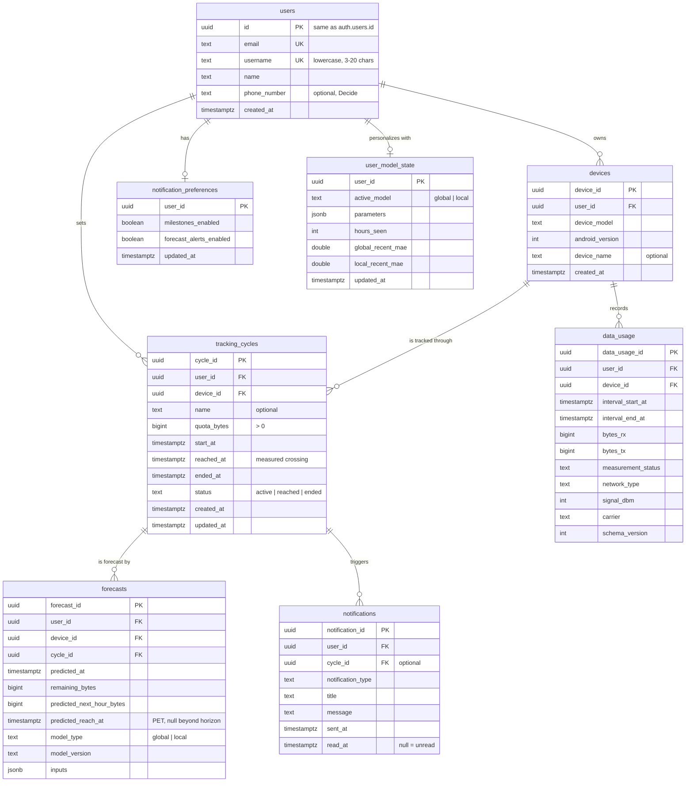
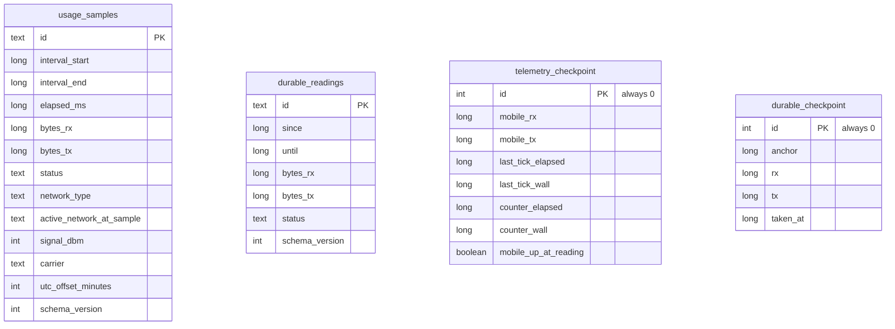

# Quota schema ERD (draft for the database admin)

**Status:** draft, 2026-11-04. The DB admin reviews and owns the final ERD. Nothing here is migrated yet. Items marked **Decide** need a team answer before the migration is written.

This builds on the "database requirements" tab of the team's review doc and updates it with what has landed since:
- **ROADMAP Decision 2:** the global model predicts next-hour usage, and the local layer is a per-user residual correction.
- **D4 telemetry** (merged in #23): defines exactly what a usage reading contains.

## Rules for every table

- **Row security:** RLS limits rows to `auth.uid() = user_id` (for `users`, `id`). There is no shared reference table in the new design.
- **Keys:** UUID primary keys, generated on the phone and reused on sync, so a retried upload upserts instead of duplicating. New tables keep the existing `<entity>_id` naming (`device_id`, `data_usage_id`, …); `users.id` stays as it is.
- **Times:** `timestamptz` in Postgres, epoch millis (`Long`) in Room, converted in the sync mapper.
- **Amounts:** bytes as `bigint`. MB is computed only for display, with 1 MB = 1,000,000 bytes, as on the Create Quota screen.
- **Secrets:** no passwords, hashes or recovery codes in public tables; Supabase Auth keeps them in `auth.users`.
- **Migrations:** every change is a new migration file. Applied migrations are never edited.

## Diagram

Synced to Supabase:



On the phone only (Room), never synced:



These four match the D4 types field for field (`UsageSample`, `DurableUsageReading`, `TelemetryCheckpoint`, `DurableCheckpoint`; see [usage telemetry](telemetry.md)). Each checkpoint must be written in the same Room transaction as the rows it belongs to.

## Tables synced to Supabase

### users (existing, no change)

Created by the `on_auth_user_created` trigger. `username` already exists (migration `20261031000001`). There is no password column, and there never was one in Postgres; the diagram's `password_hash` should be removed.
- **Decide:** keep `phone_number`? The app never asks for it.

### devices (existing, no structural change)

- `device_id` is generated once per install and stored on the phone.
- The carrier is **not** stored here. It is recorded on every usage row, so SIM changes are covered.

### tracking_cycles (new)

One quota the user set, and how it ended.

- **status**, one of:
  - `active`
  - `reached`: measured usage crossed `quota_bytes`, and `reached_at` is set
  - `ended`: the user ended the cycle first; it is not scored as a known outcome
- **Constraints:**
  - `check (quota_bytes > 0)`
  - `check (status <> 'reached' or reached_at is not null)`
  - `check (reached_at is null or reached_at >= start_at)`
- **Rule:** at most one active cycle per device, enforced by the partial unique index `(device_id) where status = 'active'`.
- **Changed from the requirements tab: no `baseline_bytes`.** The D4 counters re-baseline on every reboot and when mobile data returns, so one counter reading at cycle start cannot define usage in the cycle. Instead:
  - **Used in cycle** = the sum of the 10-minute NetworkStatsManager readings in `[start_at, now)`. NetworkStatsManager is ROADMAP's source of truth for durable totals.
  - **Remaining** = `quota_bytes` minus used.
  - A reading that starts before `start_at` is split by time (proportionally), and the split is the only estimate involved.
  - `reached_at` is the end of the reading in which the sum crossed the quota. Its uncertainty is that reading's span, at most 10 minutes plus any gap, which matches ROADMAP's "timing uncertainty" note for evaluation.

### data_usage (replaces the legacy table)

Usage history that outlives a reinstall (D7), and the observed side of the E3 evaluation.

- **Volume:** the phone keeps its 30-second `usage_samples` and syncs **one row per 10-minute window**, 144 per day instead of 2,880.
- **How a window is rolled up from its 30-second samples:**
  - `bytes_rx` and `bytes_tx`: summed.
  - `measurement_status`: the worst status in the window, in the order `COUNTER_JUMP` > `COUNTER_RESET` > `UNSUPPORTED` > `GAP` > `INTERRUPTED` > `BASELINE` > `OK`.
  - `network_type`: the cellular label that carried the most bytes, otherwise the most common label.
  - `signal_dbm`: the median of the known values, or -999 when there are none.
  - `carrier`: the last one seen.
- **Unique key:** `(device_id, interval_start_at)`, so a re-upload upserts.
- **No `cycle_id`:** cycles are found by time window, and a window can straddle a cycle start.
- **Removed:** `data_remaining_gb` and any stored daily totals. They can be computed from the rows, and a stored copy drifts.
- **Decide:**
  - Does B2's final feature list need more columns? AGENTS.md lists signal, network type and speed as model inputs. Speed is `(bytes_rx + bytes_tx) / window length` and needs no column.
  - Are 10-minute windows right for the team, or would hourly rows do? Decision 2's model works in hours; 10 minutes keeps D7's 24-hour chart finer and matches the harvester.

### forecasts (new): the prediction log

D6 logs every prediction so E3 can compare global and local accuracy. The log cannot be rebuilt later. A row stores:
- `remaining_bytes`: the input to the projection.
- `predicted_next_hour_bytes`: what Decision 2's model outputs. Its actual value comes from `data_usage`, and the local layer's residual is learned from the difference.
- `predicted_reach_at`: the PET from the hour-by-hour projection, or null when the projection passes the 30-day cap.
- `model_type`, `model_version` (the ONNX file) and `inputs` (the feature values as JSON), so every prediction can be checked later.

The actual quota-reaching time is `tracking_cycles.reached_at` and is not stored twice.
- **Decide:** sync every forecast, or only one per hour per cycle? Everything stays on the phone either way.

### notifications (replaces the legacy table)

- **notification_type:** `milestone_50`, `milestone_80`, `milestone_90`, `forecast_reminder` or `quota_reached`. Enforced with a `check`.
- **Read state:** `read_at` replaces `is_read`; empty means unread.
- **Rule:** each milestone and `quota_reached` goes out once per cycle, enforced by the partial unique index `(cycle_id, notification_type) where notification_type <> 'forecast_reminder'`. Forecast reminders may repeat, rate-limited in the app.
- **Decide:** are milestones fixed at 50/80/90%? If users can choose their own, `notification_type` becomes `milestone` with a `threshold_percent` column.

### notification_preferences (new)

One row per user (`user_id` is the primary key), matching the two Settings switches.

### user_model_state (new): the local layer's backup

- **What it holds:**
  - the per-user residual correction (`parameters`, a few numbers as JSON)
  - how many hours it has learned from
  - the recent error of the global and local predictions, which drives the reversible GLOBAL ↔ LOCAL switch (≥ 7 days and local error lower)
- **Why back it up:** so a reinstall doesn't restart personalization from zero.
- **Decide:**
  - Keep it per user, or per device? Per user assumes one phone per user.
  - Store it at all? Without a backup it is simply relearned from scratch.

## Room mapping (D2)

- **Synced tables:** each gets a Room entity of the same shape. Postgres `snake_case_plural` maps to Room `PascalCaseSingular` (`TrackingCycle`, `DataUsage`, …), with `timestamptz` ↔ `Long` and `bigint` ↔ `Long`.
- **Upload queue:** each synced entity adds a local-only `synced_at: Long?` (null = waiting to upload). It is not a Postgres column.
- **Phone-only tables:** the four D4 tables above. `TelemetryModule` swaps `InMemoryTelemetryRepository` for the Room-backed one; `TelemetryCollectorTest` is the contract it must pass.
- **Rollups:** the 10-minute `data_usage` rows are computed on the phone from `usage_samples` before upload.

## Migration plan (C2 follow-up)

1. **Check the legacy tables are empty on the hosted project.** The app has never written to them, since D2 and sync don't exist yet:
   ```sql
   select (select count(*) from public.promos) promos,
          (select count(*) from public.associations) associations,
          (select count(*) from public.data_usage) data_usage,
          (select count(*) from public.notifications) notifications;
   ```
   If any count is not 0, stop and plan a data copy instead.
2. **Drop the legacy tables:** `associations` first (it references the others), then `promos`, `providers` and the legacy `data_usage` and `notifications`. Drop the carrier seed from `seed.sql`.
3. **Create the new tables** with their constraints, indexes, RLS policies and grants: `tracking_cycles`, `data_usage`, `forecasts`, `notifications`, `notification_preferences`, `user_model_state`. Policies use `(select auth.uid())`, as in `20260917000002`.
4. **Update docs:** `supabase/README.md`, and the AGENTS.md "Data model" section.

## Open questions for the team

1. Forecasts: sync all, or one per hour per cycle?
2. B2's final feature list: does `data_usage` need more columns?
3. Milestones: fixed at 50/80/90%, or user-chosen?
4. Is `user_model_state` per user or per device, and should it be backed up at all?
5. Keep `users.phone_number`?
6. `data_usage` sync granularity: 10 minutes (recommended) or hourly?
