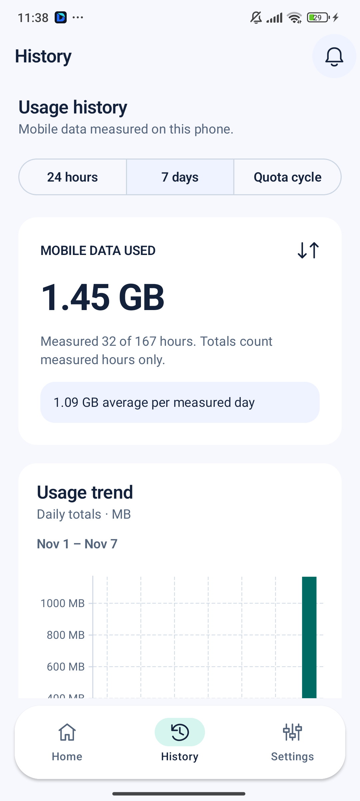
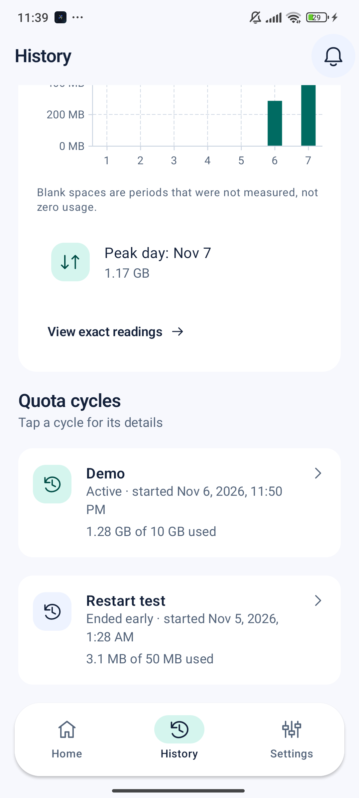

# Usage history (D7)

History shows mobile data measured on this phone and the user's quota cycles, all from Room. Nothing in it is a fixture.

Two tabs (2026-11-09): **Usage** holds the 24 hours / 7 days range chips, the total and the chart; **Quota cycles** shows the selected cycle (status, used of quota, forecast vs actual, "View cycle details" for the read-only details), its daily chart, then **All cycles**, where tapping a cycle selects it (the shown one is outlined and marked "Showing").

## Sources

| What | From |
|---|---|
| Hourly mobile bytes | `durable_readings` (10-minute NetworkStatsManager readings) through `HourlyUsage.hourlyFromWindows`, the same rule the forecast uses, so History and the PET agree hour for hour |
| Cycles | `TrackingCycleRepository.observeAll`, filtered to this device |
| Cycle used bytes | `CycleMath.usage`, the same figure as Quota Details |
| Forecast vs actual | `forecasts` of reached cycles (`ForecastDao.between`) |

The 30-second TrafficStats samples are not used: they miss usage while the phone sleeps (datara-ml `docs/measurement-gaps.md`).

## Rules (`HistoryAggregation`)

- An hour is **measured** only when the hourly rule observes it (usable readings that cover the hour). Any other hour is `null` and shown as a blank space in the chart and "Not measured" in the exact readings, never as 0. A measured hour with 0 bytes is a real zero.
- The current, still-open hour is left out.
- A day's total sums its measured hours; a day with none is a gap. Days with some unmeasured hours say "x of 24 hours measured".
- Window totals count measured hours only, and say how many hours were measured when some were not. The daily average is scaled to the measured time (`total × 24 / measured hours`), so unmeasured days don't pull it down.
- Windows: the last 24 complete hours, the last 7 local days (today included), and each cycle's days (its latest 31 at most). A cycle's chart counts whole hours, so its first and last hours can include usage just outside the cycle; the used/quota figure is exact (`CycleMath`).
- **Forecast vs actual:** for a reached cycle, the latest forecast made at least 24 hours before `reached_at`, otherwise the cycle's first forecast, using the reach time of the model that was active then. The difference is shown as "N h later/earlier than predicted".
- Fewer than 24 measured hours show a "Collecting" note; no measured hour and no cycle shows the empty state.

`HistoryViewModel` re-aggregates on `Dispatchers.Default` whenever a reading or a cycle is stored.

## Tests

- `HistoryAggregationTest` (JVM): gaps vs zeros, unusable readings, daily totals, measured-time average, cycle progress, the open hour, PET comparison choice and wording.
- `HistoryScreenTest` (Compose): empty and populated states, gaps in the readings sheet, read-only cycle details, both at 2× font.

 
