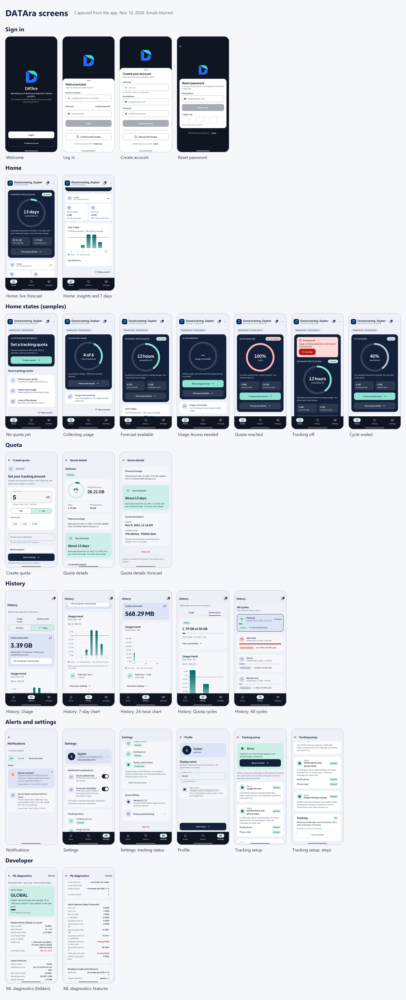

# DATAra screens

Every screen of the app as of Nov 10, 2026 (after PR #45), captured from the running app: signed-in screens on the demo phone (POCO F3), sign-in screens on an emulator so the demo phone stayed signed in. Sign-in emails are blurred and the status bar is blanked.

The **Home states** are the review-only samples from *Preview options*, captured just before that menu was removed in v0.9.1; every other screen shows real data. A few texts have since been shortened (PR #47). **Choose a username** is not captured: it only appears for a signed-in account without a username, and it uses the same navy card layout as Reset password.

## Sign in

| Screen | Image |
|---|---|
| Welcome | [01-welcome.png](01-welcome.png) |
| Log in | [02-log-in.png](02-log-in.png) |
| Create account (username, email, password) | [03-create-account.png](03-create-account.png) |
| Reset password (email code) | [04-reset-password.png](04-reset-password.png) |

## Home

| Screen | Image |
|---|---|
| Live forecast ring (the demo phone's "Defense" quota) | [10-home-forecast.png](10-home-forecast.png) |
| Insights and the last 7 days | [11-home-insights.png](11-home-insights.png) |

## Home states (samples from Preview options)

| Screen | Image |
|---|---|
| No quota yet | [20-home-no-quota.png](20-home-no-quota.png) |
| Collecting usage | [21-home-collecting.png](21-home-collecting.png) |
| Forecast available | [22-home-forecast-sample.png](22-home-forecast-sample.png) |
| Usage Access needed | [23-home-access-needed.png](23-home-access-needed.png) |
| Quota reached | [24-home-quota-reached.png](24-home-quota-reached.png) |
| Tracking off | [25-home-tracking-off.png](25-home-tracking-off.png) |
| Cycle ended | [26-home-cycle-ended.png](26-home-cycle-ended.png) |

## Quota

| Screen | Image |
|---|---|
| Create quota | [30-create-quota.png](30-create-quota.png) |
| Quota details | [31-quota-details.png](31-quota-details.png) |
| Quota details: forecast and cycle info | [32-quota-details-forecast.png](32-quota-details-forecast.png) |

## History

| Screen | Image |
|---|---|
| Usage tab | [40-history-usage.png](40-history-usage.png) |
| 7-day chart | [41-history-7-days.png](41-history-7-days.png) |
| 24-hour chart | [42-history-24-hours.png](42-history-24-hours.png) |
| Quota cycles tab | [43-history-quota-cycles.png](43-history-quota-cycles.png) |
| All cycles | [44-history-all-cycles.png](44-history-all-cycles.png) |

## Alerts and settings

| Screen | Image |
|---|---|
| Notifications | [50-notifications.png](50-notifications.png) |
| Settings | [60-settings.png](60-settings.png) |
| Settings: tracking status | [61-settings-status.png](61-settings-status.png) |
| Profile | [62-profile.png](62-profile.png) |
| Tracking setup | [63-tracking-setup.png](63-tracking-setup.png) |
| Tracking setup: steps | [64-tracking-setup-steps.png](64-tracking-setup-steps.png) |

## Developer

| Screen | Image |
|---|---|
| ML diagnostics (hidden: tap the Settings version 7 times) | [70-ml-diagnostics.png](70-ml-diagnostics.png) |
| ML diagnostics: input features | [71-ml-diagnostics-features.png](71-ml-diagnostics-features.png) |

To refresh: capture again with the same file names (1080 px phone captures resized to 540 px wide) and rebuild `overview.png`.
